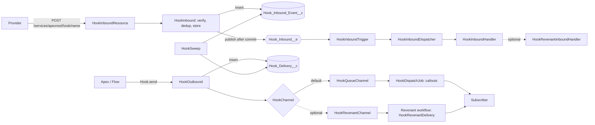
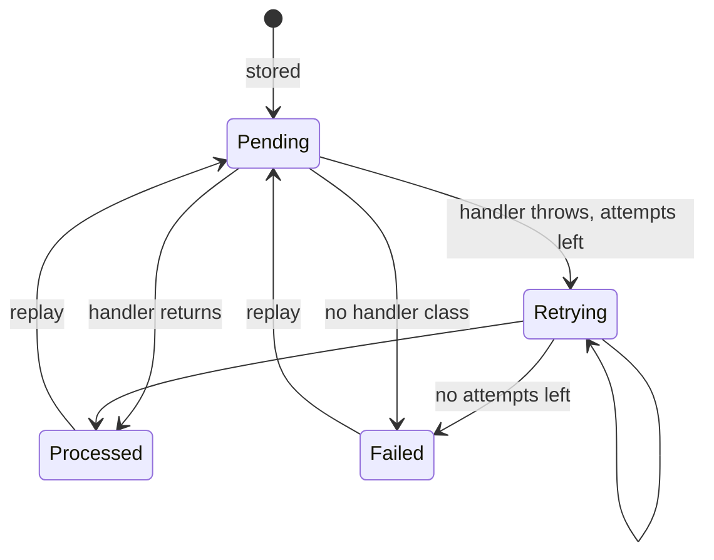
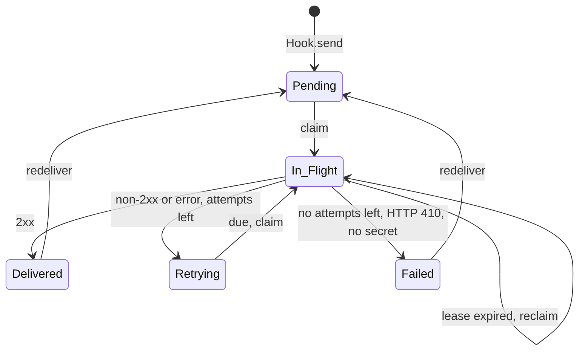

# Hook Design: Inbound and Outbound Webhooks for Salesforce

Status: accepted. Date: 2026-10-18.

## 1. Problem

Apex REST makes an endpoint easy. A webhook needs more than an endpoint.

- **Inbound:** A provider (Stripe, GitHub, Slack, Shopify) calls Salesforce with no Salesforce session. The request comes through a Site guest user. The code must verify a signature over the raw body, stop replays, ignore duplicates, and send a 2xx in a few seconds. The work must run later, as a trusted user, with retries.
- **Outbound:** Salesforce sends an event to a subscriber. Apex blocks a callout after DML and in a trigger. The code must sign the request, retry with backoff, keep a log, stop calls to a dead endpoint, and let an operator send again.

Hook is a general library for both. An optional adapter runs a delivery or an inbound event as a durable Revenant workflow.

## 2. Brainstorming

Ideas, then the selection.

| Idea | Keep? | Reason |
|------|-------|--------|
| One Apex REST class for all inbound endpoints, routed by the last path segment | Yes | One class to expose on the Site. Configuration adds an endpoint. |
| Endpoint configuration in Custom Metadata (`Hook_Endpoint__mdt`) | Yes | Deployable. Readable by the guest user in Apex. |
| Secrets in a protected list Custom Setting (`Hook_Secret__c`) | Yes | Not in source control. Not in a metadata deploy. Supports rotation. |
| Built-in verifiers: Standard Webhooks, Stripe, GitHub, Slack, Shopify, generic HMAC, shared token, none | Yes | Covers most providers. A custom class covers the rest. |
| Store the raw event first (`Hook_Inbound_Event__c`), then process async | Yes | Fast 2xx. The record is the source of truth. |
| Platform Event (`Hook_Inbound__e`, publish after commit) to start processing | Yes | The subscriber runs as the Automated Process user, not as the guest user. |
| Deduplicate with a unique external Id (`Dedup_Key__c`) | Yes | The database enforces it. No race. |
| Outbound subscriptions in a custom object (`Hook_Subscription__c`) | Yes | Apex must update it (failure count, auto-disable). Custom Metadata cannot take DML. |
| Outbound format: Standard Webhooks (`webhook-id`, `webhook-timestamp`, `webhook-signature`) | Yes | An open specification with libraries in many languages. |
| Transactional outbox: `Hook.send` inserts `Hook_Delivery__c` and enqueues a Queueable | Yes | A Queueable runs only when the transaction commits. Safe in triggers. |
| Claim with `FOR UPDATE`, a claim token and a lease | Yes | Two dispatchers cannot send the same row. A dead job does not strand a row. |
| Schedulable sweep for retries, lost jobs, and purge | Yes | One safety net for both directions. |
| Pluggable delivery channel (`HookChannel`) | Yes | The Revenant adapter plugs in here. |
| Flow actions: Send Webhook, Replay | Yes | Admins can send without Apex. |
| Flow inbound handler | Yes | Admins can process without Apex. |
| UI (LWC console) | No | Standard tabs and list views are enough for v1. |
| IP allow list | No | Use Site and Network settings. Add later if asked. |
| Strict ordering | No | Webhooks are not ordered. The receiver must accept any order. |

## 3. Reverse Brainstorming: How Do We Make the Worst Webhook Library?

| Way to fail | Effect | Remedy (AC) |
|-------------|--------|-------------|
| Verify the signature over a re-serialized body | Valid requests fail | Verify the raw request bytes (AC-IN-3) |
| Compare signatures with `==` | Timing leak | Constant-time compare (AC-SEC-1) |
| Accept an old signed request | Replay attack | Timestamp tolerance, default 300 s (AC-IN-5) |
| Read headers case-sensitively | Valid requests fail | Case-insensitive header map (AC-IN-4) |
| Process in the guest user transaction | Slow 2xx, guest permissions, provider retries | Store, then process async as a trusted user (AC-IN-7) |
| Store twice when the provider retries | Duplicate side effects | Unique dedup key, 200 for a duplicate (AC-IN-6) |
| Lose the event when the async step fails | Silent data loss | Record is the source of truth. Sweep picks up stale and due rows (AC-IN-9, AC-SW-1) |
| One bad event stops the batch | Head-of-line block | Savepoint for each event. Isolate the failure (AC-IN-8) |
| Put secrets in Custom Metadata | Secrets in Git | Protected Custom Setting (AC-SEC-2) |
| No secret rotation | Downtime on rotation | Current and previous secret with an expiry (AC-SEC-3) |
| Call out from a trigger | `CalloutException` | Outbox and Queueable (AC-OUT-1) |
| Retry at once in a loop | Endpoint overload, CPU limit | Exponential backoff with jitter and a cap (AC-OUT-6) |
| Retry forever | Unbounded storage and jobs | Maximum attempts, then `Failed` (AC-OUT-7) |
| Keep calling a dead endpoint | Waste of limits | Auto-disable after N failures. HTTP 410 disables at once (AC-OUT-8, AC-OUT-9) |
| Two jobs send the same row | Duplicate delivery | Claim token, `FOR UPDATE`, lease (AC-OUT-5) |
| Ignore `Retry-After` | Throttle ban | Honor `Retry-After` for 429 and 503 (AC-OUT-6) |
| Send to `http://` | Data in clear text | Validation rule: `https://` or `callout:` only (AC-SEC-4) |
| Keep every log row forever | Storage limit | Purge after retention days (AC-SW-3) |
| 100 callouts of 10 s in one job | Callout time limit | Batch size and timeout keep the job below 120 s (AC-OUT-10) |
| Store the full response body | Storage, secrets in logs | Truncate to 2000 characters (AC-OUT-4) |
| Store `Authorization` and `Cookie` headers | Credential leak | Drop them before storage (AC-SEC-5) |
| Hard dependency on Revenant | Users without Revenant cannot install | Adapter in its own package folder (AC-RV-4) |

## 4. Six Thinking Hats

**White (facts).**
- A Site guest user can call an Apex REST class that its profile or a permission set allows.
- `RestRequest.requestBody` holds the raw bytes for JSON. For `application/x-www-form-urlencoded` the platform parses the body into `params`. The raw bytes are not available.
- Apex blocks a callout after uncommitted DML. A Queueable runs only after its transaction commits.
- `System.enqueueJob(job, delayMinutes)` accepts a delay of 0 to 10 minutes.
- Apex cron does not accept a minute step. Four jobs give a 15-minute sweep.
- A platform event trigger runs as the Automated Process user. `setResumeCheckpoint` lets it process part of a batch.
- Each `setSavepoint` and `rollback` counts as one DML statement.
- A long text area holds at most 131,072 characters.
- A transaction allows 100 callouts and 120 s of total callout time.

**Red (feelings).**
- Admins fear webhooks because the guest user setup is unclear. The setup guide must be short and exact.
- Developers want "it just works" defaults. The defaults must be safe.

**Black (risks).**
- We cannot run Apex tests without an org in this session. Mitigation: apex-ls compile, shared test vectors checked by Node, Code Analyzer, and an org test workflow in CI.
- Form-encoded inbound bodies cannot be verified byte for byte. Mitigation: document the limit. JSON providers work.
- Platform event allocations are finite. Mitigation: one event for each inbound request, and a sweep fallback.
- Many concurrent dispatch chains under high volume. Mitigation: each chain ends when no row is due.

**Yellow (benefits).**
- One configuration record adds an inbound endpoint.
- One line of Apex (`Hook.send('order.paid', order)`) sends a signed, retried webhook.
- Standard Webhooks lets subscribers use existing verify libraries.
- With Revenant, each delivery gets durable sleep, retry, watchdog, and audit history.

**Green (alternatives).**
- Revenant channel per subscription (`Channel__c`), so one org can mix queue and durable delivery.
- Inbound Revenant handler starts a workflow or signals a running one.
- Test vectors in one JSON file. Node checks them against `node:crypto`. Apex tests read the same file as a static resource.

**Blue (process).**
- Plan, then RED (tests that fail), GREEN (minimum code), REFACTOR.
- Gates: Prettier, apex-ls compile, Node tests, global API manifest, Code Analyzer, org tests with 85% coverage.
- Review from several angles. Fix the findings. Report each AC with evidence.

## 5. Architecture

### Inbound states

### Outbound states

## 6. Acceptance Criteria

### Inbound

- **AC-IN-1** `POST /services/apexrest/hook/{name}` routes to the active `Hook_Endpoint__mdt` record `{name}`. An unknown or inactive name returns 404.
- **AC-IN-2** Built-in schemes verify: `STANDARD_WEBHOOKS`, `STRIPE`, `GITHUB`, `SLACK`, `SHOPIFY`, `HMAC_SHA256`, `TOKEN`, `NONE`. `Verifier_Class__c` sets a custom `HookVerifier`.
- **AC-IN-3** A verifier signs the raw request bytes. A changed body returns 401.
- **AC-IN-4** Header lookup ignores case.
- **AC-IN-5** A timestamp outside the tolerance (default 300 s) returns 401, for the schemes that sign a timestamp.
- **AC-IN-6** A valid request stores one `Hook_Inbound_Event__c` and returns 200. A second request with the same event Id stores nothing and returns 200 with status `duplicate`.
- **AC-IN-7** The store publishes `Hook_Inbound__e` after commit. The trigger calls the endpoint's `HookInboundHandler` and sets `Processed`.
- **AC-IN-8** A handler exception rolls back the handler DML for that event only. Other events in the batch continue.
- **AC-IN-9** A failed event goes to `Retrying` with a backoff time. After the maximum attempts it goes to `Failed`. A missing or wrong handler class goes to `Failed` at once.
- **AC-IN-10** A body above 131,072 characters returns 413. A non-UTF-8 body returns 400.
- **AC-IN-11** The Slack scheme answers `url_verification` with the challenge. A handler or verifier that implements `HookHandshake` can answer GET and POST handshakes. A GET with no handshake returns 405.
- **AC-IN-12** `Hook.replayInbound(ids)` sets `Pending` and publishes again.
- **AC-IN-13** `HookFlowHandler` starts the autolaunched Flow named in `Handler_Config__c`.
- **AC-IN-14** An unexpected error returns 500, so the provider retries.

### Outbound

- **AC-OUT-1** `Hook.send(type, payload)` inserts one `Hook_Delivery__c` for each active subscription whose `Event_Types__c` matches (`*`, exact, or prefix `order.*`). It makes no callout in the caller transaction.
- **AC-OUT-2** The body is `{"id","type","timestamp","data"}`. Headers are `webhook-id`, `webhook-timestamp`, `webhook-signature` (`v1,<base64>`), `Content-Type: application/json`.
- **AC-OUT-3** `Hook.send` with the same event Id twice makes one delivery for each subscription.
- **AC-OUT-4** A 2xx sets `Delivered`. Each attempt records the status code, the error, and up to 2000 characters of the response.
- **AC-OUT-5** The dispatcher claims rows with `FOR UPDATE`, a claim token, and a lease. An expired lease can be claimed again.
- **AC-OUT-6** A non-2xx, a timeout, or a `CalloutException` sets `Retrying`. The next time uses exponential backoff with jitter and a cap. HTTP 429 and 503 use `Retry-After` when present.
- **AC-OUT-7** After the maximum attempts (subscription value, else the org default 10) the row goes to `Failed`.
- **AC-OUT-8** HTTP 410 sets `Failed` and disables the subscription.
- **AC-OUT-9** After `Disable_After_Failures__c` failed attempts in a row, the subscription is disabled. A 2xx sets the count to 0. The dispatcher does not claim rows of an inactive subscription.
- **AC-OUT-10** One job sends at most `Batch_Size__c` rows (default 10) with `Timeout_Ms__c` (default 10,000). It chains a new job when more rows are due.
- **AC-OUT-11** `Hook.redeliver(ids)` sets `Pending`, resets the attempts, and dispatches again.
- **AC-OUT-12** The Flow action "Send Webhook" calls `Hook.send`. The Flow action "Replay Webhook" calls redeliver or replay by record type.
- **AC-OUT-13** A payload above 131,072 characters throws `HookException`.
- **AC-OUT-14** A subscription with no secret fails the attempt with a clear error.

### Security

- **AC-SEC-1** Signature compare is constant time.
- **AC-SEC-2** Secrets are in the protected Custom Setting `Hook_Secret__c`.
- **AC-SEC-3** `Hook.rotateSecret(name, graceHours)` makes a new `whsec_` secret and keeps the old one until the grace time ends. Inbound accepts both. Outbound signs with both.
- **AC-SEC-4** A subscription endpoint must start with `https://` or `callout:`.
- **AC-SEC-5** Stored inbound headers do not include `Authorization`, `Cookie`, or `Proxy-Authorization`.
- **AC-SEC-6** The guest permission set gives only the REST class and the platform event create.

### Sweep

- **AC-SW-1** `HookSweep` claims due outbound rows and expired leases, and publishes due or stale inbound rows.
- **AC-SW-2** `Hook.scheduleSweep()` schedules four jobs (every 15 minutes). `Hook.unscheduleSweep()` removes them.
- **AC-SW-3** The sweep deletes `Delivered` and `Processed` rows older than `Retention_Days__c` (default 30).

### Revenant adapter

- **AC-RV-1** `HookRevenantChannel` starts one `HookRevenantDelivery.DeliveryWorkflow` for each delivery with `startOrGet`. A second dispatch before an attempt starts nothing new.
- **AC-RV-2** `HookRevenantDelivery.DeliverStep` is a `CalloutStep`. 2xx completes. 429 or 503 with `Retry-After` sleeps. Other failures retry. The final attempt, 410, and a missing secret fail. A delivered row completes with no callout.
- **AC-RV-3** `HookRevenantInboundHandler` starts a workflow (`mode: start`) or sends a signal (`mode: signal`) with the dedup key as the idempotency key.
- **AC-RV-4** The core package compiles and deploys with no Revenant code.

### Quality

- **AC-Q-1** Each AC has a test. Org tests give at least 85% coverage of Hook classes.
- **AC-Q-2** apex-ls compiles all package folders with 0 issues.
- **AC-Q-3** Prettier and Code Analyzer (severity 2) pass.
- **AC-Q-4** The `global` surface is equal to `docs/api.md`. A Node test checks it.
- **AC-Q-5** Test vectors are checked by `node:crypto` and by Apex.
- **AC-Q-6** Docs: README (quick start, Site setup), API, ADRs. Text follows ASD-STE100.

## 7. Test Plan

| Layer | Tool | Scope |
|-------|------|-------|
| Vectors | `node --test` | HMAC values in `HookTestVectors.json`, the Standard Webhooks published vector |
| API | `node --test` | `global` declarations equal to `docs/api.md` |
| Compile | apex-ls | All package folders, with Revenant as a submodule |
| Unit and integration | Apex tests in a scratch org | Every AC above |
| Static | Prettier, Code Analyzer | All Apex |

## 8. Decisions

- [ADR 0001](../adr/0001-store-then-process-inbound.md): Store, then process inbound events through a platform event.
- [ADR 0002](../adr/0002-outbox-claim-lease.md): Outbound outbox with claim token and lease.
- [ADR 0003](../adr/0003-secrets-in-protected-custom-setting.md): Secrets in a protected Custom Setting.
- [ADR 0004](../adr/0004-revenant-adapter-package.md): Revenant adapter as a separate package folder.
